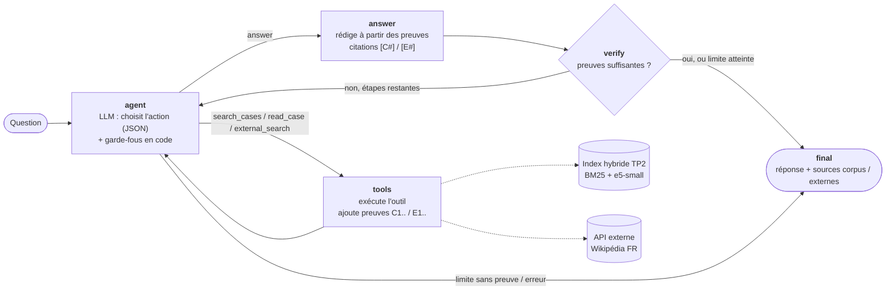

# Assistant juridique local : extraction (TP1), RAG (TP2) et Agentic RAG (TP3)

Application web **100 % locale** sur la jurisprudence de la Cour de cassation
(dataset Hugging Face [`antoinejeannot/jurisprudence`](https://huggingface.co/datasets/antoinejeannot/jurisprudence)) :

- **TP2 — RAG** : recherche d'affaires (BM25, embeddings ou hybride), sélection d'une décision,
  **résumé structuré** et **questions-réponses** fondées sur les passages cités ;
- **TP3 — Agentic RAG** : un agent (LangGraph) qui **décide** quand rechercher, quelle affaire lire,
  s'il faut consulter une source externe, **vérifie** ses preuves avant de répondre, et affiche sa
  **trace en direct** ;
- **TP1 — extraction de relations** : toujours disponible sur `/tp1` (voir [docs/README_TP1.md](docs/README_TP1.md)).

Le modèle tourne en local via **Ollama** (`llama3.2:3b` par défaut pour le RAG et l'agent).

## Lancer le système

```bash
pip install -r requirements.txt
ollama pull llama3.2:3b                      # LLM local (Ollama doit tourner sur le port 11434)

python -m scripts.prepare_juris --n 2000     # corpus : ~2 000 décisions publiées au Bulletin (≈ 2 min)
python -m scripts.build_index                # index BM25 + embeddings (≈ 20-40 min sur CPU)
#   python -m scripts.build_index --no-dense # variante rapide : BM25 seul (≈ 1 min)

uvicorn backend.main:app --port 8000
# puis ouvrir http://localhost:8000  (onglets « Recherche d'affaires » et « Agent juridique »)
```

Exécuter les 3 scénarios du TP3 (traces dans `docs/traces/`) et les tests :

```bash
python -m scripts.run_scenarios
python -m scripts.agent_cli "Ma question juridique" --url http://localhost:8000   # trace dans le terminal
pytest -q
```

Variables utiles : `RAG_MODEL` (défaut `llama3.2:3b`), `EMBED_MODEL` (défaut
`intfloat/multilingual-e5-small`), `LLM_BASE_URL`, `EXTERNAL_API` (défaut Wikipédia FR).

## Architecture agentique (TP3)



| Élément | Rôle |
|---|---|
| **État partagé** (`AgentState`) | question, mémoire (affaire précédente), preuves numérotées, décisions trouvées (D1, D2…), recherches faites, affaires lues, itération / limite, retour du vérificateur, brouillon, statut, réponse finale |
| `search_cases(query, k)` | recherche hybride dans l'index du TP2 ; un numéro de pourvoi (`23-20.161`) donne un accès direct |
| `read_case(case_id)` | lit une décision « comme un juriste » : sommaire officiel + meilleur passage de l'exposé, des moyens, des motivations et du dispositif |
| `external_search(query)` | Wikipédia FR, source marquée **externe** (jamais présentée comme de la jurisprudence) ; validation humaine possible |
| **Garde-fous** | action inconnue → recherche ; réponse sans preuve → recherche ; recherche répétée / affaire déjà lue → réponse ou nouvelle piste ; affaire citée par son numéro → lecture obligatoire |
| **Vérificateur** | preuves du corpus présentes, citations valides, affaire demandée citée, pas de phrase non sourcée (contrôle lexical), cohérence réponse/passages (juge LLM) ; si échec → retour à l'agent avec le motif |
| **Arrêt** | réponse vérifiée, **5 étapes maximum** (réglable), ou erreur contrôlée (LLM injoignable, outil en erreur) |

L'interface affiche, pendant le run, le nœud actif du graphe et chaque étape (DECISION, TOOL,
OBSERVATION, GÉNÉRATION, CHECK, FINAL, ERREUR) via un flux SSE, puis la réponse avec les sources
séparées **corpus / externes** et les mesures (appels LLM, outils, tokens, durée).

Bonus réalisés : **mémoire** (l'affaire de la question précédente est proposée à l'agent),
**human-in-the-loop** (validation avant l'appel externe), **observabilité** (appels LLM, tokens,
latence par étape), vérificateur séparé du rédacteur.

## RAG (TP2)

- **Corpus** : décisions de la Cour de cassation depuis 2015, publiées au Bulletin, avec découpage
  en zones ; échantillon équilibré par chambre (`scripts/prepare_juris.py`).
- **Découpage** : par zone juridique (introduction, exposé, moyens, motivations, dispositif), fenêtres
  de 170 mots avec 35 mots de recouvrement ; le **sommaire officiel** et les thèmes forment un passage à part.
- **Index** : BM25 (tokenisation française, racinisation Snowball) + embeddings
  `multilingual-e5-small`, fusion par **Reciprocal Rank Fusion**.
- **Résumé** : faits / procédure / question de droit / décision / portée, chaque information citée [P#],
  citations contrôlées par le code ; résumés mis en cache.
- **Questions-réponses** : retrieval restreint à l'affaire, réponse JSON avec citations, réponse
  « information absente » si les passages ne suffisent pas.

## Organisation du code

| Fichier | Rôle |
|---|---|
| `backend/juris/corpus.py` | chargement, zones, découpage en passages |
| `backend/juris/index.py` | index hybride BM25 + dense, RRF |
| `backend/juris/rag.py` | recherche, résumé, questions-réponses, RAG statique (référence) |
| `backend/juris/llm.py` | appels JSON au LLM local et compteurs (observabilité) |
| `backend/agent/tools.py` | les 3 outils de l'agent |
| `backend/agent/graph.py` | graphe LangGraph : agent, outils, réponse, vérificateur, final |
| `backend/agent/runner.py` | runs en arrière-plan, flux de trace, validation humaine, mémoire, sauvegarde des traces |
| `backend/juris_api.py` | routes `/api/juris/*` et `/api/agent/*` |
| `frontend/app/` | interface web (HTML/CSS/JS sans dépendance) |
| `scripts/run_scenarios.py` | les 3 scénarios + comparaison avec le RAG statique |
| `docs/traces/` | traces des 3 scénarios (JSON + Markdown) |
| `docs/rapport/` | rapport LaTeX |
| `tests/` | tests (faux LLM) : TP1, index, recherche, boucle agentique, garde-fous, erreurs d'outil |
